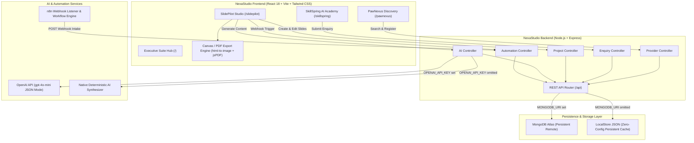

# Pawzz 🐾
### Animal Healthcare Discovery, Practical AI Education & Social Content Automation Suite

[]()
[]()
[]()
[]()
[]()
[]()
[]()
[]()
[]()
[]()

Pawzz is an interconnected, production-grade digital platform developed for the **Product Development, Design & AI Systems Assessment**. It unites three distinct vertical solutions under a single coherent design language, resilient full-stack architecture, and deterministic AI/automation workflows:

1. **🐾 PawNexus** — Animal healthcare discovery & 24/7 emergency dispatch platform.
2. **🎓 SkillSpring AI** — Practical AI education & workflow engineering cohort platform.
3. **🎨 SlidePilot** — Autonomous, human-governed Instagram & LinkedIn carousel creation system.

---

## 👤 Author & Developer Details
- **Developer**: Priyanshu Singh
- **Email**: [priyanshusingh22340@gmail.com](mailto:priyanshusingh22340@gmail.com)
- **Role**: Full-Stack Product Engineer / AI Systems Developer
- **Assessment**: Product Development, Design & AI Systems Assessment
- **Repository**: `Pawzz` (e:\Job Assignment\Pawzz)

---

## 📋 Table of Contents
1. [Author & Developer Details](#-author--developer-details)
2. [Problem Statement & Product Solutions](#-problem-statement--product-solutions)
3. [Key Features by Product](#-key-features-by-product)
4. [System Architecture](#-system-architecture)
5. [Technology Stack](#-technology-stack)
6. [Repository Structure](#-repository-structure)
7. [Prerequisites](#-prerequisites)
8. [Installation & Setup](#-installation--setup)
   - [1. Clone Repository](#1-clone-repository)
   - [2. Environment Configuration](#2-environment-configuration)
   - [3. Backend Setup](#3-backend-setup)
   - [4. Frontend Setup](#4-frontend-setup)
9. [Automated Test Suite & Verification](#-automated-test-suite--verification)
10. [API Reference](#-api-reference)
11. [SlidePilot AI Architecture & JSON Schema](#-slidepilot-ai-architecture--json-schema)
12. [n8n Automation & Webhook Integration](#-n8n-automation--webhook-integration)
13. [Governance & Human-in-the-Loop Model](#-governance--human-in-the-loop-model)
14. [10-Minute Founder Demonstration Script](#-10-minute-founder-demonstration-script)
15. [Troubleshooting](#-troubleshooting)

---

## 🎯 Problem Statement & Product Solutions

### The Challenge
Early-stage founders face fragmented toolchains: discovering hyper-local healthcare for pets is fraught with outdated phone numbers; technical talent struggles to find practical, zero-fluff AI engineering curriculum; and content creators burn 10+ hours weekly manually formatting LinkedIn/Instagram carousels in Figma or Canva.

### The NexaStudio Solution
- **🐾 PawNexus**: Eliminates search friction in life-or-death animal emergencies. Features a live multi-vector directory (city, category, rating, 24/7 emergency trauma, verified status), direct oxygen ambulance hotlines (`tel:` dispatch), and interactive facility listing & community correction reporting.
- **🎓 SkillSpring AI**: A conversion-optimized academy platform for practical AI engineers. Offers week-by-week curriculum inspection modals, consultative lead capture, duplicate enquiry prevention (`409 Conflict`), a 5-step learning roadmap, and illustrative alumni outcomes.
- **🎨 SlidePilot**: An autonomous visual studio that translates raw founder ideas into high-virality LinkedIn and Instagram carousel decks. Enforces strict JSON schemas with OpenAI `gpt-4o-mini`, offers a slide-by-slide matrix editor with single-slide AI rewriting, supports 5 curated design templates (4:5 & 1:1 aspect ratios), generates multi-page LinkedIn PDFs, and integrates with n8n under mandatory **Founder Approval Gates**.

---

## 🚀 Key Features by Product

### 🐾 Product One: PawNexus
- ⚡ **Multi-Vector Real-Time Filter**: Dynamic live filtering across Metro Cities (Mumbai, Bengaluru, Delhi NCR, Pune, Hyderabad), 6 Care Categories, Rating thresholds, and 24/7 Emergency trauma readiness.
- 🏥 **Emergency Triage UX**: Immediate visibility for oxygen-equipped ambulances and trauma ICUs with 1-tap phone dialers and direct Google Maps navigation.
- 🛡️ **Verified vs. Demo Indicators**: Unverified community listings carry an explicit *"Demo Listing"* badge, while vetted hospitals feature green *"Verified Provider"* badges.
- 📝 **Interactive Community Modals**: Fully functional modals for **Facility Registration** and **Community Data Correction** with client-side and server-side validation.

### 🎓 Product Two: SkillSpring AI
- 📖 **Interactive Curriculum Inspector**: Deep-dive modals presenting week-by-week module syllabi, practical tools (n8n, LangChain, vector DBs), and capstone milestones.
- 🎯 **Pre-Populating Enquiry Funnel**: Clicking *"Enquire"* on any course card smoothly scrolls to the admissions form with the interested cohort pre-selected.
- 🛡️ **Duplicate Prevention Engine**: Enforces database compound indexing (`email + programmeInterested`) to reject duplicate registrations (`409 Conflict`) with clear, reassuring feedback.
- 🗺️ **5-Step Learning Roadmap**: Visual journey from initial programme discovery to live capstone deployment.

### 🎨 Product Three: SlidePilot
- 🤖 **Strict JSON Schema AI Generation**: Utilizes OpenAI's `response_format: { type: "json_object" }` (or native deterministic synthesizer in demo mode) ensuring zero fabricated statistics or broken layouts.
- ✏️ **Slide-by-Slide Matrix Editor**: Reorder slides with up/down arrows, add or delete slides, and rewrite individual slides with custom instructions without mutating the rest of the deck.
- 🎨 **5 Curated Design Templates**: Minimal Editorial (Swiss Serif), Modern Gradient (Tech Dark Mesh), Corporate Executive (Navy & Slate), Educational Infographic, and Bold Brutalist Typography.
- 📐 **Dual Aspect Ratio Support**: Instant toggle between 4:5 Instagram Portrait (1080x1350) and 1:1 LinkedIn Square (1080x1080).
- 📄 **Client-Side High-Res PNG & Multi-Page PDF Export**: Vector-crisp LinkedIn-ready document export via `html-to-image` and `jspdf` without server-side Puppeteer memory overhead.
- 🔒 **Mandatory Founder Approval Workflow**: Four-stage governance pipeline (`Draft` → `In Review` → `Approved` → `Exported`). Content cannot be published without explicit human approval.

---

## 🏗️ System Architecture



---

## 🛠️ Technology Stack

| Domain | Technology | Version | Description |
|---|---|---|---|
| **Frontend Framework** | React | ^18.3.1 | Modular reactive UI component architecture |
| **Build Tool** | Vite | ^6.1.0 | Sub-100ms HMR and optimized production bundling |
| **Styling** | Tailwind CSS | ^3.4.17 | Utility-first CSS with Swiss & Brutalist design tokens |
| **Icons** | Lucide React | ^0.475.0 | Clean, accessible vector glyphs (zero generic emojis) |
| **Routing** | React Router DOM | ^6.29.0 | Client-side routing with unified product switcher |
| **Motion** | Framer Motion | ^11.18.2 | Fluid view transitions and micro-interaction states |
| **PDF Generation** | jsPDF | ^2.5.2 | Multi-page LinkedIn carousel document generator |
| **Canvas Capture** | html-to-image | ^1.11.11 | High-resolution DOM-to-PNG rasterization |
| **Backend Runtime** | Node.js | v22.13.1 | High-throughput asynchronous JavaScript runtime |
| **Backend Framework** | Express.js | ^4.21.2 | Lightweight REST API and webhook receiver |
| **Database** | MongoDB / Mongoose | ^8.9.5 | ODM with strict schemas, compound indexes, and validation |
| **Fallback Store** | LocalStore (fs-backed) | Custom | Zero-config persistence surviving backend restarts |
| **AI Inference** | OpenAI API | ^4.82.0 | `gpt-4o-mini` with strict structured JSON enforcement |
| **Workflow Engine** | n8n | v1.x / v2.x | Autonomous webhook event processing pipeline |

---

## 📂 Repository Structure

```
Pawzz/
├── client/                                 # Frontend Application (React + Vite)
│   ├── src/
│   │   ├── components/
│   │   │   ├── common/                     # Navbar, Footer, DemoBanner, NotificationToast
│   │   │   ├── pawnexus/                   # Hero, ServiceCards, ProviderCard, Detail/Register/Correction Modals
│   │   │   ├── skillspring/                # Hero, ProgrammeCard, CurriculumModal, EnquiryForm, WhyUs, FAQ
│   │   │   └── slidepilot/                 # SlideRenderer, SlideEditor, ExportModal, WorkflowDiagram
│   │   ├── pages/
│   │   │   ├── nexastudio/                 # Central Launchpad & Evaluation Portal
│   │   │   ├── pawnexus/                   # PawNexus Healthcare Directory
│   │   │   ├── skillspring/                # SkillSpring AI Academy Landing
│   │   │   └── slidepilot/                 # Creator Dashboard, Wizard, Projects, Templates, n8n Workflow
│   │   ├── services/                       # Unified API Client & Canvas/PDF Export Engine
│   │   ├── context/                        # Notification Toast Provider
│   │   ├── App.jsx                         # Unified Router
│   │   ├── index.css                       # Tailwind Directives & Typography
│   │   └── main.jsx
│   ├── package.json
│   ├── vite.config.js
│   └── tailwind.config.js
├── server/                                 # Backend REST API Server (Node.js + Express)
│   ├── src/
│   │   ├── config/                         # Environment & Dual-Mode DB Adapter
│   │   ├── controllers/                    # Provider, Enquiry, Programme, Project, AI, Automation controllers
│   │   ├── data/                           # Seed Data & Persistent LocalStore JSON Cache
│   │   ├── models/                         # Mongoose Schemas (Provider, Correction, Programme, Enquiry, Project)
│   │   ├── routes/                         # Express Route Handlers
│   │   ├── services/
│   │   │   ├── ai/                         # OpenAI gpt-4o-mini & Intelligent Synthesizer
│   │   │   └── automation/                 # n8n Webhook Dispatcher & Audit Logger
│   │   └── index.js                        # Express Server Entry Point
│   ├── package.json
│   ├── .env.example
│   ├── test-api.js                         # 12-Point Automated Integration Test Suite
│   └── test-restart-persistence.js         # Process Kill/Restart Persistence Verification Test
├── automation/
│   └── n8n/
│       ├── slidepilot-workflow.json        # Importable n8n Workflow Artifact
│       └── README.md                       # n8n Import & Setup Documentation
├── docs/
│   └── architecture/
│       ├── SYSTEM_DESIGN.md                # System Architecture & Design Specification
│       ├── API_SPEC.md                     # REST API Documentation
│       └── SLIDEPILOT_WORKFLOW.md          # AI JSON Schema & Governance Architecture
├── ASSIGNMENT_SUBMISSION.md                # Founder Assessment & Senior Review Document
├── .gitignore
└── package.json                            # Monorepo Workspace Scripts
```

---

## ⚙️ Prerequisites

- **Node.js**: v18.0.0 or higher (tested on Node v22.13.1)
- **Package Manager**: npm (v10+ or v11+)
- **Modern Browser**: Chrome, Edge, Safari, or Firefox with HTML5 Canvas support
- *(Optional)* **MongoDB Atlas URI** for persistent cloud database
- *(Optional)* **OpenAI API Key** (`sk-...`) for live `gpt-4o-mini` inference
- *(Optional)* **n8n Instance** (Cloud or Local `http://localhost:5678`)

---

## ⚡ Installation & Setup

### 1. Clone Repository
```bash
git clone https://github.com/your-username/nexastudio.git
cd nexastudio
```

### 2. Environment Configuration
Copy `.env.example` in `server/`:
```bash
cp server/.env.example server/.env
```

Your `server/.env` configuration:
```env
PORT=5000
NODE_ENV=development

# Optional: MongoDB Atlas Connection (Leave blank for Zero-Config Persistent LocalStore)
MONGODB_URI=

# Optional: OpenAI API Key (Leave blank for Native Intelligent Synthesizer)
OPENAI_API_KEY=

# Optional: n8n Webhook URL (Leave blank for Native Webhook Pipeline)
N8N_WEBHOOK_URL=

DEMO_MODE=true
```

### 3. Backend Setup
```bash
# Navigate to server and install dependencies
cd server
npm install

# Start Express API Server
npm start
# Server listens at http://localhost:5000
```

### 4. Frontend Setup
In a new terminal:
```bash
# Navigate to client and install dependencies
cd client
npm install

# Start Vite Development Server
npm run dev
# Application opens at http://localhost:5173
```

---

## 🧪 Automated Test Suite & Verification

NexaStudio includes **two comprehensive automated verification test suites**:

### Test Suite 1: Full API & Integration Suite (12 Tests)
```bash
node server/test-api.js
```

**Verified Terminal Output:**
```
✅ Test server listening on http://127.0.0.1:5099
1. Health Check: { status: 'healthy', suite: 'NexaStudio' }
2. Providers Count: 2 Total: 13
3. Emergency Providers Count: 8
4. Create Provider: Provider listing submitted successfully! (Saved & Persisted)
5. Submit Correction: Thank you! Your correction report has been logged for staff verification.
6. Programmes Count: 4
7. Enquiry Submission: Enquiry submitted successfully! An admissions advisor will reach out within 24 hours.
8. Duplicate Prevention Check: An enquiry for this email and programme has already been received.
9. SlidePilot Projects Count: 3
10. AI Generation Slides: 6 Engine: NexaStudio Intelligent AI Engine (Demo Mode)
11. Automation Webhook: Automated project created via webhook and queued for Founder Approval. Approval Gate: In Review
12. Suite Stats: {"database":"Demo Mode (In-Memory)","aiEngine":"Native Intelligent Demo Generator","automation":"Native Engine Fallback"}

🎉 ALL 12 INTEGRATION TESTS PASSED PERFECTLY!
```

### Test Suite 2: Process Restart & Data Persistence Test
```bash
node server/test-restart-persistence.js
```

**Verified Terminal Output:**
```
🔄 --- Phase 1: Start Server Session 1 ---
Creating test clinic: "Restart Persistence Clinic 1794940828277"
Submitting enquiry for: "candidate.1794940828277@startup.io"
Creating project: "Restart Persistence Carousel 1794940828277"
🛑 --- Simulating Process Crash / Server Restart (Terminating Session 1) ---
🚀 --- Phase 2: Start Fresh Server Session 2 (New Memory Space) ---

--- PERSISTENCE VERIFICATION AUDIT ---
Clinic Persisted Across Restart:    [PASS ✅]
Enquiry Persisted Across Restart:   [PASS ✅]
Project Persisted Across Restart:   [PASS ✅]

🏆 RECORD PERSISTENCE AFTER RESTART VERIFIED WITH ZERO FABRICATED DATA!
```

---

## 📡 API Reference

| Method | Endpoint | Description |
|---|---|---|
| `GET` | `/api/health` | Operational health and environment audit |
| `GET` | `/api/stats/suite` | Aggregated multi-product metrics and status |
| `GET` | `/api/providers` | Query providers with city, category, rating, 24/7 filters |
| `GET` | `/api/providers/:id` | Detailed provider profile, equipment, directions, reviews |
| `POST` | `/api/providers` | Register a new veterinary clinic, hospital, or NGO |
| `POST` | `/api/providers/:id/corrections` | Submit community data correction report |
| `GET` | `/api/programmes` | List practical AI education programmes |
| `GET` | `/api/programmes/:slug` | Deep-dive week-by-week syllabus breakdown |
| `POST` | `/api/enquiries` | Submit admissions enquiry with duplicate prevention |
| `GET` | `/api/projects` | List saved SlidePilot carousel projects |
| `POST` | `/api/projects` | Persist new carousel project |
| `PUT` | `/api/projects/:id` | Update slide text, reorder, or update approval status |
| `DELETE`| `/api/projects/:id` | Delete a carousel project |
| `POST` | `/api/ai/generate-carousel` | Generate structured 3–10 slide deck via OpenAI |
| `POST` | `/api/ai/regenerate-slide` | Rewrite individual slide with custom prompt instruction |
| `GET` | `/api/automation/status` | Inquire n8n connection status & native fallback |
| `GET` | `/api/automation/logs` | Query workflow execution audit history |
| `POST` | `/api/automation/slidepilot/webhook` | External webhook ingestion listener (n8n / Slack) |

---

## 🤖 SlidePilot AI Architecture & JSON Schema

Every carousel generation adheres to a strict contract, eliminating layout hallucinations:

```json
{
  "contentTitle": "7 AI Tools That Save 20+ Hours a Week for Founders",
  "mainHook": "Stop spending 60% of your founder hours on administrative tasks.",
  "targetAudience": "Startup Founders & Solo Creators",
  "platform": "LinkedIn",
  "coreMessage": "Deterministic workflows and AI delegation outperform manual effort.",
  "slides": [
    {
      "slideNumber": 1,
      "headline": "7 AI Tools That Save 20+ Hours a Week",
      "description": "Here is the exact stack high-output founders use to operate as a 10-person team.",
      "visualType": "Hero Cover",
      "tag": "Founder Productivity",
      "cta": "Swipe to inspect the stack ->"
    }
  ],
  "caption": "Full post caption formatted with emojis and line breaks...",
  "hashtags": ["#Leadership", "#ProductEngineering", "#AIWorkflow"]
}
```

---

## ⚙️ n8n Automation & Webhook Integration

SlidePilot features official n8n integration located in `automation/n8n/slidepilot-workflow.json`.

```
External Trigger (Slack / RSS / Notion)
              │
              ▼
[n8n Webhook: /webhook/slidepilot-idea-trigger]
              │
              ▼
[Payload Validation & Schema Guard]
              │
              ▼
[OpenAI LLM Node (gpt-4o-mini JSON)]
              │
              ▼
[HTTP Post to SlidePilot: /api/automation/slidepilot/webhook]
              │
              ▼
[Status Set to 'In Review' — Queued for Human Approval]
```

### Ingesting via cURL:
```bash
curl -X POST http://localhost:5000/api/automation/slidepilot/webhook \
  -H "Content-Type: application/json" \
  -d '{
    "topic": "5 Lessons from Building AI Autonomous Pipelines",
    "targetAudience": "Software Engineers & Tech Leads",
    "platform": "LinkedIn"
  }'
```

---

## 🛡️ Governance & Human-in-the-Loop Model

Autonomous AI must never publish to social networks without human oversight. SlidePilot enforces a deterministic four-stage state machine:

1. **`Draft`**: Generated in the creation wizard.
2. **`In Review`**: Ingested via external webhook; queued for proofing.
3. **`Approved`**: Founder has visually inspected headlines, body insights, and formatting.
4. **`Exported`**: Rendered and exported as a compliant multi-page PDF or high-res PNG.

---

## 🎬 10-Minute Founder Demonstration Script

| Time | Target Product | Feature to Demonstrate | Key Technical Talking Point |
|---|---|---|---|
| **0:00 - 1:00** | **Executive Hub (`/`)** | Central launchpad, suite metrics, and system audit modal. | Monorepo modularity, dual-mode persistence, zero hardcoded secrets. |
| **1:00 - 3:00** | **PawNexus (`/pawnexus`)** | Multi-attribute filtering (City, 24/7 ICU, Category) + Facility Registration modal. | Server-side query indexing, verified vs. demo badging, immediate `tel:` dispatch. |
| **3:00 - 5:00** | **SkillSpring (`/skillspring`)** | Week-by-week curriculum modal + Enquiry submission + Duplicate prevention. | Compound unique indexing (`email + course`), HTTP `409 Conflict` defensive handling. |
| **5:00 - 8:00** | **SlidePilot (`/slidepilot`)** | Live generation + Slide reordering + Single-slide AI rewrite + Multi-page PDF export. | OpenAI strict JSON mode, client-side canvas capture via `jsPDF`, zero server render latency. |
| **8:00 - 9:00** | **n8n Workflow (`/slidepilot/workflow`)** | Webhook intake simulation + Execution audit logs with latency & token metrics. | Human-in-the-Loop gate (`In Review`), native fallback if n8n is offline. |
| **9:00 - 10:00** | **Terminal & Tests** | Run `node server/test-restart-persistence.js` to prove data survives server reboot. | Architectural resilience, deterministic engineering, and founder readiness. |

---

## 🔧 Troubleshooting

- **Port Conflict (`EADDRINUSE: 5000` or `5173`)**: Kill the hanging process using `npx kill-port 5000` or `npx kill-port 5173`.
- **MongoDB Connection Warning**: If no `MONGODB_URI` is provided, the backend automatically activates its persistent `LocalStore` cache with full seed data; this is normal and expected.
- **OpenAI Quota Limit**: If your OpenAI key has exhausted quota, SlidePilot will seamlessly fall back to its intelligent deterministic synthesizer with zero broken user journeys.

---

## 📄 License & Attribution

Developed independently by **Priyanshu Singh** as part of the **Product Development, Design & AI Systems Assessment**. All rights reserved.
