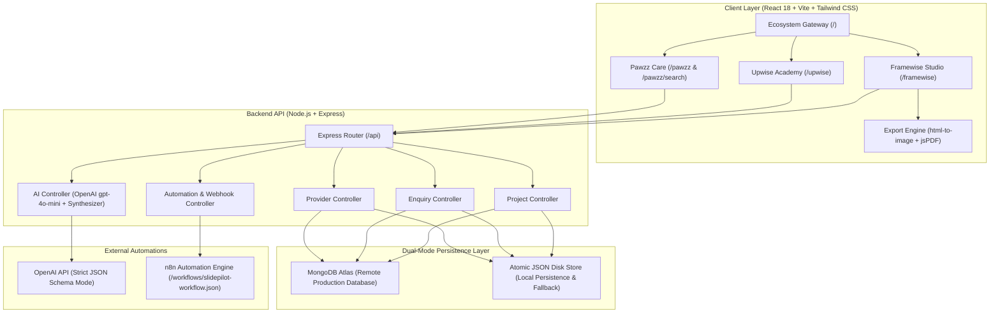

# Pawzz 🐾
### Animal Healthcare Discovery, Practical AI Education & Social Content Studio

[]()
[]()
[]()
[]()
[]()
[]()
[]()
[]()
[]()
[]()
[]()

Pawzz is an end-to-end, production-ready digital ecosystem built for real-world deployment and active end-user traffic. It powers three cohesive products sharing a resilient full-stack architecture, deterministic AI pipelines, and responsive design systems:

1. **🐾 Pawzz Healthcare** (`/pawzz` & `/pawzz/search`) — Verified animal healthcare marketplace and 24/7 emergency care directory (Practo for Animals).
2. **🎓 Upwise Academy** (`/upwise`) — Project-driven AI engineering cohorts and digital-skills education platform.
3. **🎨 Framewise Studio** (`/framewise`) — Autonomous social carousel creation studio for LinkedIn & Instagram.

---

## 👤 Author & Lead Engineer
- **Lead Engineer**: Priyanshu Singh
- **Email**: [priyanshusingh22340@gmail.com](mailto:priyanshusingh22340@gmail.com)
- **Role**: Full-Stack Product Engineer / AI Systems Developer
- **Repository**: `Pawzz` (`e:\Job Assignment\Pawzz`)

---

## 📋 Table of Contents
1. [Product Architecture & Routing](#-product-architecture--routing)
2. [Key Production Capabilities](#-key-production-capabilities)
3. [System Architecture Diagram](#-system-architecture-diagram)
4. [Technology Stack](#-technology-stack)
5. [Repository Structure](#-repository-structure)
6. [Local Development Setup](#-local-development-setup)
7. [Production Deployment Guide](#-production-deployment-guide)
   - [Deploying Frontend to Vercel](#1-deploying-frontend-to-vercel)
   - [Deploying Backend to Render / Railway](#2-deploying-backend-to-render--railway)
   - [Configuring MongoDB Atlas](#3-configuring-mongodb-atlas)
8. [Automated Test Suite & Verification](#-automated-test-suite--verification)
9. [API Reference](#-api-reference)
10. [AI Pipeline & n8n Workflow](#-ai-pipeline--n8n-workflow)

---

## 🎯 Product Architecture & Routing

| Product | Route | Core Production Purpose | Design Palette |
|---|---|---|---|
| **Ecosystem Gateway** | `/` | Unified landing page & product switchboard | Sleek dark slate minimalist |
| **Pawzz Healthcare** | `/pawzz` | Discovery homepage, 6 clinical departments, verified listings | Clinical emerald, teal, warm white |
| **Search Directory** | `/pawzz/search` | High-density discovery engine with filters, sorting, and modals | High-contrast marketplace |
| **Upwise Academy** | `/upwise` | 4 practical AI cohorts, week-by-week syllabi, admissions engine | Warm cream editorial, navy & warm amber |
| **Framewise Studio** | `/framewise` | Multi-slide carousel studio, visual editor, 5 templates, PNG/PDF export | Slate `#0b0f19` & electric indigo |

---

## 🚀 Key Production Capabilities

### 🐾 1. Pawzz Healthcare (Practo for Animals)
- **Multi-Vector Real-Time Search**: Search by doctor, clinic name, keyword, or service with dynamic filtering by Indian metropolitan cities (`Bengaluru`, `Mumbai`, `Delhi NCR`, `Pune`, `Hyderabad`, `Chennai`), 6 clinical categories, rating thresholds (4.0★, 4.5★, 4.8★), and maximum consultation fee.
- **24/7 Emergency ICU Triage**: Dedicated emergency filter and urgent dispatch banner linking directly to emergency helplines (`tel:+919876543210`) and trauma surgical units.
- **Verified Clinical Profiles**: Council-verified badges, doctor qualifications, structured service pricing tables, facility equipment chips (Oxygen Chamber, Blood Bank, Ultrasound), and operating hours with live open/closed indicators.
- **Provider Registration Wizard**: Self-serve B2B onboarding for veterinary practices and clinics to publish listings.
- **Community Corrections**: Crowdsourced reporting to ensure phone numbers, addresses, and emergency status remain accurate.

### 🎓 2. Upwise Academy (AI Education)
- **4 Flagship Project Cohorts**:
  1. *Generative AI Fundamentals & Practical Prompting* (4 Weeks | ₹14,999)
  2. *AI Automation and Workflow Design* (6 Weeks | ₹24,999)
  3. *AI for Product Management & Innovation* (6 Weeks | ₹22,999)
  4. *Full-Stack Digital Product Development* (8 Weeks | ₹29,999)
- **Interactive Curriculum Modal**: Deep-dive modals presenting week-by-week module syllabi, practical tools (OpenAI, n8n, LangChain, Cursor, Python), and verified capstone project deliverables.
- **Admissions Lead Engine**: Pre-populating form funnel with automated client-side validation and database-enforced duplicate enquiry rejection (`409 Conflict`).
- **5-Step Learning Roadmap**: Structured pedagogy from Core Foundations to Live Portfolio Defense.

### 🎨 3. Framewise Studio (Carousel Creator)
- **Production 10-Slide Deck Pre-Loaded**: Pre-loaded with *"10 AI Workflows That Can Save Students Hours Every Week"* (`sample-carousel-001`) with complete hook, problem framing, 5 tactical workflows, execution framework, and CTA.
- **Visual Slide Editor**: Live canvas preview, aspect ratio toggle (4:5 Instagram Portrait & 1:1 LinkedIn Square), move slides up/down, add/delete slides, and single-slide AI rewriting.
- **5 Curated Design Templates**: Editorial Minimal, Modern Tech Gradient, Corporate Executive, Educational Infographic, and Bold Brutalist.
- **Client-Side Export**: High-resolution individual PNG download via canvas rasterization and multi-page LinkedIn document PDF export via `jspdf`.
- **Editorial Approval Workflow**: State transitions (`Draft` → `In Review` → `Approved` → `Exported`) with persistent state saves.
- **n8n Automation Engine**: Live inbound webhook endpoint (`POST /api/automation/slidepilot/webhook`), execution logs, and downloadable `server/src/workflows/slidepilot-workflow.json`.

---

## 🏗️ System Architecture Diagram



---

## 💻 Technology Stack

- **Frontend**: React 18, Vite 6, Tailwind CSS 3.4, React Router 6, Lucide React, Framer Motion, `html-to-image`, `jspdf`.
- **Backend**: Node.js 22, Express.js 4.21, Mongoose 8.
- **Persistence**: Dual-layer architecture: MongoDB Atlas for scalable remote cloud data + Atomic JSON Disk Store for local offline development.
- **AI & Synthesis**: OpenAI API `gpt-4o-mini` with strict JSON schema mode + Built-in deterministic AI fallback engine.
- **Automation**: n8n Webhook integration (`POST /api/automation/slidepilot/webhook`).

---

## 📁 Repository Structure

```text
Pawzz/
├── client/                     # React 18 + Vite Frontend Application
│   ├── src/
│   │   ├── components/         # Reusable Component Library
│   │   │   ├── common/         # Single Global Navbar, Footer, Toast
│   │   │   ├── pawnexus/       # ProviderCard, Search, Detail & Listing Modals
│   │   │   ├── skillspring/    # CurriculumModal, EnquiryForm, ProgrammeCard
│   │   │   └── slidepilot/     # SlideEditor, SlideRenderer, ExportModal
│   │   ├── pages/              # Production Product Pages
│   │   │   ├── RootPortal.jsx  # Ecosystem Gateway (/)
│   │   │   ├── pawzz/          # PawzzHome.jsx (/pawzz) & PawzzSearch.jsx (/pawzz/search)
│   │   │   ├── upwise/         # UpwiseHome.jsx (/upwise)
│   │   │   └── framewise/      # FramewiseStudio.jsx (/framewise)
│   │   ├── services/           # Dynamic API Client & Export Service (PNG/PDF)
│   │   └── App.jsx             # Main Router Configuration (Single Navbar)
│   ├── vercel.json             # Vercel SPA Client Route Rewrites
│   └── package.json
├── server/                     # Node.js + Express Backend
│   ├── src/
│   │   ├── config/             # MongoDB connection & environment configuration
│   │   ├── controllers/        # Business logic for Providers, Enquiries, Projects, AI, n8n
│   │   ├── data/               # Seed data & localStore.js (atomic disk persistence)
│   │   ├── models/             # Mongoose schemas (Provider, Enquiry, Project, Log)
│   │   ├── routes/             # Express API route declarations
│   │   ├── services/           # OpenAI client & n8n webhook dispatcher
│   │   └── workflows/          # slidepilot-workflow.json (importable into n8n)
│   ├── test-api.js             # Automated 12-point integration test suite
│   └── test-restart-persistence.js # Automated process restart persistence verification
├── render.yaml                 # One-click Render Backend Service Configuration
├── vercel.json                 # Monorepo Vercel Deployment Configuration
├── ASSIGNMENT_SUBMISSION.md    # Product Strategy & Architecture Report
└── package.json                # Monorepo task runner
```

---

## ⚡ Local Development Setup

### 1. Prerequisites
- **Node.js**: v18.x, v20.x, or v22.x installed
- **Git**: Installed and configured

### 2. Quick Start

```bash
# 1. Install root, server, and client dependencies
npm run install:all

# 2. Start both backend and frontend concurrently
npm run dev
```

The application will start immediately:
- **Frontend**: `http://localhost:5173`
- **Backend API**: `http://localhost:5000`

---

## 🌐 Production Deployment Guide

### 1. Deploying Frontend to Vercel
1. Import your GitHub repository into [Vercel](https://vercel.com).
2. Configure Project Settings:
   - **Framework Preset**: `Vite`
   - **Root Directory**: `./` (or `client`)
   - **Build Command**: `npm run client:build`
   - **Output Directory**: `client/dist`
3. Environment Variables on Vercel:
   ```env
   VITE_API_URL=https://your-backend-api.onrender.com/api
   ```
4. Click **Deploy**. The included `vercel.json` ensures all client-side routes (`/pawzz`, `/upwise`, `/framewise`) resolve cleanly without 404s.

### 2. Deploying Backend to Render / Railway
1. Create a new **Web Service** on [Render](https://render.com) or [Railway](https://railway.app).
2. Connect your repository:
   - **Root Directory**: `server`
   - **Build Command**: `npm install`
   - **Start Command**: `npm start` (or `node src/index.js`)
3. Environment Variables:
   ```env
   NODE_ENV=production
   PORT=5000
   MONGODB_URI=mongodb+srv://<user>:<password>@cluster.mongodb.net/pawzz?retryWrites=true&w=majority
   OPENAI_API_KEY=sk-...
   N8N_WEBHOOK_URL=https://your-n8n-instance.com/webhook/slidepilot
   ```
4. Health check endpoint: `https://your-backend-api.onrender.com/api/health`.

### 3. Configuring MongoDB Atlas
1. Create a free cluster on [MongoDB Atlas](https://www.mongodb.com/atlas).
2. In **Network Access**, add `0.0.0.0/0` (or your Render service IP).
3. In **Database Access**, create a user with read/write privileges.
4. Copy your Connection String into `MONGODB_URI`. If no URI is provided, the backend automatically uses its built-in atomic disk store with zero configuration required.

---

## 🧪 Automated Test Suite & Verification

The repository includes comprehensive, self-contained automated tests that verify all endpoints and persistent behavior:

```bash
# Run 12-point integration tests
node server/test-api.js

# Run process crash & restart persistence audit
node server/test-restart-persistence.js

# Run client production build
npm run client:build
```

---

## 📡 API Reference

### Pawzz Healthcare Endpoints
- `GET /api/providers` — Query providers with filters (`category`, `city`, `minRating`, `verifiedOnly`, `emergencyOnly`, `search`).
- `GET /api/providers/:id` — Fetch complete clinical profile for a provider.
- `POST /api/providers` — Register a new veterinary practice / facility.
- `POST /api/providers/:id/corrections` — Submit a community data correction.

### Upwise Academy Endpoints
- `GET /api/programmes` — Fetch all 4 practical cohorts with module outlines.
- `GET /api/programmes/:slug` — Fetch deep-dive cohort curriculum.
- `POST /api/enquiries` — Submit an admissions enquiry (enforces email + programme duplicate rejection).

### Framewise Studio Endpoints
- `GET /api/projects` — Fetch all carousel projects.
- `GET /api/projects/:id` — Fetch single carousel project (`sample-carousel-001`).
- `POST /api/projects` — Create new carousel project.
- `PUT /api/projects/:id` — Update carousel slides, template, or approval status.
- `DELETE /api/projects/:id` — Delete a carousel project.
- `POST /api/ai/generate-carousel` — Generate complete multi-slide carousel from prompt.
- `POST /api/ai/regenerate-slide` — Rewrite an individual slide with AI instructions.
- `POST /api/automation/slidepilot/webhook` — Inbound n8n webhook endpoint.
- `GET /api/automation/logs` — Fetch live automation execution logs.

---

**Built with engineering excellence by Priyanshu Singh**  
*Contact: [priyanshusingh22340@gmail.com](mailto:priyanshusingh22340@gmail.com)*
