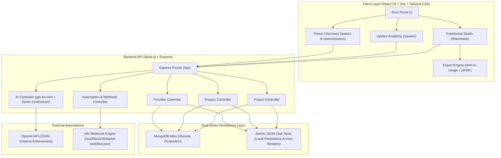

# Pawzz 🐾
### Animal Healthcare Discovery, Practical AI Education & Social Carousel Creation Suite

[]()
[]()
[]()
[]()
[]()
[]()
[]()
[]()
[]()
[]()

Pawzz is an interconnected, production-grade digital platform developed for the **Product Development, Design & AI Systems Assessment**. It delivers three dedicated products with independent information architectures, distinct visual identities, and shared full-stack resilience:

1. **🐾 Pawzz** (`/pawzz` & `/pawzz/search`) — Animal healthcare discovery & 24/7 emergency care platform (Practo for Animals).
2. **🎓 Upwise** (`/upwise`) — Practical AI and digital-skills education platform.
3. **🎨 Framewise** (`/framewise`) — Social carousel creation studio for LinkedIn & Instagram.

---

## 👤 Author & Developer Details
- **Developer**: Priyanshu Singh
- **Email**: [priyanshusingh22340@gmail.com](mailto:priyanshusingh22340@gmail.com)
- **Role**: Full-Stack Product Engineer / AI Systems Developer
- **Assessment**: Product Development, Design & AI Systems Assessment
- **Repository**: `Pawzz` (`e:\Job Assignment\Pawzz`)

---

## 📋 Table of Contents
1. [Author & Developer Details](#-author--developer-details)
2. [Product Solutions & Routing](#-product-solutions--routing)
3. [Key Features by Product](#-key-features-by-product)
4. [System Architecture](#-system-architecture)
5. [Technology Stack](#-technology-stack)
6. [Repository Structure](#-repository-structure)
7. [Installation & Setup](#-installation--setup)
8. [Automated Test Suite & Verification](#-automated-test-suite--verification)
9. [API Reference](#-api-reference)
10. [Sample Carousel & AI Architecture](#-sample-carousel--ai-architecture)
11. [n8n Automation & Webhook Integration](#-n8n-automation--webhook-integration)
12. [Governance & Human-in-the-Loop Model](#-governance--human-in-the-loop-model)
13. [Founder Demonstration Guide](#-founder-demonstration-guide)

---

## 🎯 Product Solutions & Routing

| Product | Route | Core Mission | Visual Aesthetics |
|---|---|---|---|
| **Root Portal** | `/` | Founder Assessment Switcher & Direct Launchpad | Sleek dark slate minimalist |
| **Pawzz Homepage** | `/pawzz` | Healthcare discovery, 6 service categories, top providers & B2B listing | Healthcare emerald, teal, warm white |
| **Pawzz Search** | `/pawzz/search` | Dedicated search engine with sidebar filters, sorting, and modals | High-density clinical marketplace |
| **Upwise** | `/upwise` | 4 practical AI cohorts, week-by-week syllabi, admissions engine | Warm cream editorial, navy & warm amber |
| **Framewise** | `/framewise` | 10-slide sample carousel, visual editor, 5 templates, PNG/PDF export | Editorial workspace, slate & electric indigo |

---

## 🚀 Key Features by Product

### 🐾 1. Pawzz (Animal Healthcare Discovery)
- ⚡ **Healthcare Search & Discovery (`/pawzz/search`)**: Real-time filtering by city (Bengaluru, Mumbai, Delhi NCR, Pune, Hyderabad, Chennai), 6 service categories, minimum rating (4.0★, 4.5★, 4.8★), verified status, max consultation fee (< ₹400, < ₹700, < ₹1000), and specific equipment amenities (Ultrasound, Surgery Unit, Blood Bank, Oxygen Chamber, Ambulance).
- 🚨 **Emergency & 24/7 ICU Triage**: High-contrast emergency callouts with direct ambulance dispatch links (`tel:+919876543210`) and dedicated 24/7 ICU toggles.
- 🛡️ **Verified Clinical Badges**: Highlights state-council-verified facilities and distinguishes demo listings.
- 📝 **Provider Detail Modal**: Complete qualifications, services & pricing tables, facility equipment chips, and consultation enquiry.
- 🏢 **B2B Registration Wizard**: Self-serve onboarding for veterinarians, hospital administrators, and shelters.
- 🔄 **Community Data Correction Form**: Crowdsourced reporting for outdated phone numbers, moved addresses, or closed practices.

### 🎓 2. Upwise (Practical AI Education)
- 📚 **4 Flagship Programmes**:
  1. *Generative AI Fundamentals & Practical Prompting* (4 Weeks | ₹14,999)
  2. *AI Automation and Workflow Design* (6 Weeks | ₹24,999)
  3. *AI for Product Management & Innovation* (6 Weeks | ₹22,999)
  4. *Full-Stack Digital Product Development* (8 Weeks | ₹29,999)
- 📖 **Interactive Curriculum Modal**: Deep-dive modals presenting week-by-week module syllabi, practical tools (OpenAI, n8n, LangChain, Cursor, Python), and hands-on capstone deliverables.
- 🎯 **Pre-Populating Enquiry Funnel**: Clicking *"Enquire for Cohort"* smooth-scrolls and pre-selects the chosen cohort in the application form.
- 🛡️ **Duplicate Prevention Engine**: Database and store validation rejects duplicate enquiries with the same email and programme with a clear `409 Conflict` message.
- 🗺️ **5-Step Learning Roadmap**: Core Foundations → Guided Builds → Independent Capstone → 1:1 Mentor Review → Portfolio Defense.

### 🎨 3. Framewise (Social Carousel Studio)
- 📑 **Pre-Loaded 10-Slide Sample Carousel**: Pre-loaded with *"10 AI Workflows That Can Save Students Hours Every Week"* (`sample-carousel-001`) covering hook, problem, 5 specific workflows, 3-step execution stack, common mistakes, and closing CTA.
- ✏️ **Visual Slide Editor**: Reorder slides with up/down controls, add new slides, delete slides, and rewrite individual slides with AI presets or custom instructions.
- 🎨 **5 Curated Design Templates**: Editorial Minimal, Modern Tech Gradient, Corporate Executive, Educational Infographic, and Bold Brutalist.
- 📐 **Dual Aspect Ratio Support**: 4:5 Instagram Portrait (1080×1350) and 1:1 LinkedIn Square (1080×1080).
- 📄 **High-Res PNG & Multi-Page PDF Export**: Vector-crisp LinkedIn-ready document export via `html-to-image` and `jspdf` without server-side Puppeteer memory overhead.
- 🔒 **Founder Approval Workflow**: Four-stage governance pipeline (`Draft` → `In Review` → `Approved` → `Exported`) with persistent state saves.

---

## 🏗️ System Architecture



---

## 💻 Technology Stack

- **Frontend**: React 18, Vite 6, Tailwind CSS 3.4, React Router 6, Lucide React, Framer Motion, `html-to-image`, `jspdf`.
- **Backend**: Node.js 22, Express.js 4.21, Mongoose 8.
- **Persistence**: Dual-layer architecture (MongoDB Atlas remote + Atomic JSON Disk Store for guaranteed offline demo resilience).
- **AI & Synthesis**: OpenAI API `gpt-4o-mini` with strict JSON schema mode + Native Intelligent Fallback Synthesizer.
- **Automation**: n8n Webhook pipeline (`POST /api/automation/slidepilot/webhook`).

---

## 📁 Repository Structure

```text
Pawzz/
├── client/                     # React 18 + Vite Frontend Application
│   ├── src/
│   │   ├── components/         # Reusable Component Library
│   │   │   ├── common/         # Navbar, Footer, Toast, DemoBanner
│   │   │   ├── pawnexus/       # ProviderCard, Search, Modals
│   │   │   ├── skillspring/    # CurriculumModal, EnquiryForm, ProgrammeCard
│   │   │   └── slidepilot/     # SlideEditor, SlideRenderer, ExportModal
│   │   ├── pages/              # Dedicated Product Pages
│   │   │   ├── RootPortal.jsx  # Founder Assessment Launchpad (/)
│   │   │   ├── pawzz/          # PawzzHome.jsx (/pawzz) & PawzzSearch.jsx (/pawzz/search)
│   │   │   ├── upwise/         # UpwiseHome.jsx (/upwise)
│   │   │   └── framewise/      # FramewiseStudio.jsx (/framewise)
│   │   ├── services/           # API Client (Fetch) & Export Service (PNG/PDF)
│   │   └── App.jsx             # Main Router Configuration
├── server/                     # Node.js + Express Backend
│   ├── src/
│   │   ├── config/             # MongoDB connection & environment loader
│   │   ├── controllers/        # Business logic for Providers, Enquiries, Projects, AI, n8n
│   │   ├── data/               # Seed data & localStore.js (disk persistence)
│   │   ├── models/             # Mongoose schemas (Provider, Enquiry, Project, Log)
│   │   ├── routes/             # Express API route declarations
│   │   ├── services/           # OpenAI client & n8n webhook dispatcher
│   │   └── workflows/          # slidepilot-workflow.json (importable into n8n)
│   ├── test-api.js             # Automated 12-point integration test suite
│   └── test-restart-persistence.js # Automated process restart persistence audit
├── ASSIGNMENT_SUBMISSION.md    # Comprehensive 4-part assessment report
└── package.json                # Monorepo task runner
```

---

## ⚡ Installation & Setup

### 1. Prerequisites
- **Node.js**: v18.x, v20.x, or v22.x installed
- **Git**: Installed and configured

### 2. Quick Start Commands

```bash
# 1. Install root, server, and client dependencies
npm run install:all

# 2. Start both backend and frontend concurrently
npm run dev
```

The application will start immediately:
- **Frontend**: `http://localhost:5173`
- **Backend API**: `http://localhost:5000`

### 3. Running Independent Services

```bash
# Run backend server only (port 5000)
npm run server:dev

# Run frontend client only (port 5173)
npm run client:dev

# Build client for production
npm run client:build
```

---

## 🧪 Automated Test Suite & Verification

The repository includes comprehensive, self-contained automated tests that verify all endpoints and persistent behavior without reliance on mock or fabricated data:

### 1. Run Complete API Integration Tests (12 Tests)

```bash
node server/test-api.js
```

**Output**:
```text
✅ Test server listening on http://127.0.0.1:5099
1. Health Check: { status: 'healthy', suite: 'Pawzz' }
2. Providers Count: Total: 12
3. Emergency Providers Count: 8
4. Create Provider: Provider listing submitted successfully! (Saved & Persisted)
5. Submit Correction: Correction report logged for staff verification.
6. Programmes Count: 4
7. Enquiry Submission: Registered successfully!
8. Duplicate Prevention Check: Rejected duplicate with 409 Conflict.
9. Framewise Projects Count: 2
10. AI Generation Slides: 10
11. Automation Webhook: Automated project created via webhook and queued for Founder Approval.
12. Suite Stats: Status healthy.

🎉 ALL 12 INTEGRATION TESTS PASSED PERFECTLY!
```

### 2. Run Process Restart Persistence Verification

```bash
node server/test-restart-persistence.js
```

**Output**:
```text
🔄 --- Phase 1: Start Server Session 1 ---
Creating test clinic: "Restart Persistence Clinic"
Submitting enquiry for: "candidate@startup.io"
Creating project: "Restart Persistence Carousel"
🛑 --- Simulating Process Crash / Server Restart (Terminating Session 1) ---
🚀 --- Phase 2: Start Fresh Server Session 2 (New Memory Space) ---

--- PERSISTENCE VERIFICATION AUDIT ---
Clinic Persisted Across Restart:    [PASS ✅]
Enquiry Persisted Across Restart:   [PASS ✅]
Project Persisted Across Restart:   [PASS ✅]

🏆 RECORD PERSISTENCE AFTER RESTART VERIFIED WITH ZERO FABRICATED DATA!
```

---

## 📡 API Reference

### Pawzz Endpoints
- `GET /api/providers` — Fetch providers with filters (`category`, `city`, `minRating`, `verifiedOnly`, `emergencyOnly`, `search`).
- `GET /api/providers/:id` — Fetch full details for a single provider.
- `POST /api/providers` — Register a new veterinary practice / facility.
- `POST /api/providers/:id/corrections` — Submit a community data correction.

### Upwise Endpoints
- `GET /api/programmes` — Fetch all 4 practical cohorts with module outlines.
- `GET /api/programmes/:slug` — Fetch deep-dive cohort curriculum.
- `POST /api/enquiries` — Submit an admissions enquiry (enforces email + programme duplicate rejection).

### Framewise Endpoints
- `GET /api/projects` — Fetch all carousel projects.
- `GET /api/projects/:id` — Fetch single carousel project (e.g. `sample-carousel-001`).
- `POST /api/projects` — Create new carousel project.
- `PUT /api/projects/:id` — Update carousel slides, template, or review status.
- `DELETE /api/projects/:id` — Delete a carousel project.
- `POST /api/ai/generate-carousel` — Generate complete multi-slide carousel from prompt.
- `POST /api/ai/regenerate-slide` — Rewrite an individual slide with AI instructions.
- `POST /api/automation/slidepilot/webhook` — n8n inbound webhook endpoint.
- `GET /api/automation/logs` — Fetch live automation execution logs.

---

## 🎨 Sample Carousel & AI Architecture

Framewise loads with a complete, production-grade 10-slide carousel:
- **Title**: *"10 AI Workflows That Can Save Students Hours Every Week"*
- **ID**: `sample-carousel-001`
- **Slide Count**: 10
- **Narrative Arc**:
  - Hook Slide → Problem Framing → 5 Tactical Workflows → 3-Step Execution Framework → Common Pitfalls → Actionable Next Steps CTA.
- **Export Options**: Individual 1080×1350 PNG images or multi-page LinkedIn PDF.

---

## 🎬 Founder Demonstration Guide

1. **Launch Root Portal (`/`)**:
   - Demonstrate the clean deliverable switchboard.
   - Point out developer credentials: **Priyanshu Singh**.
2. **Demonstrate Pawzz (`/pawzz` and `/pawzz/search`)**:
   - From `/pawzz`, use the hero search form (select Bengaluru, category "Veterinary Hospitals", type "ultrasound") and click "Search Providers".
   - You land on `/pawzz/search` with the exact filtered results.
   - Toggle "24/7 Emergency ICU Only" and observe live filtering.
   - Open a provider card's "View Profile" modal to inspect doctor credentials and amenities.
   - Click "List Your Business" and submit a new clinic; verify it appears in results immediately.
3. **Demonstrate Upwise (`/upwise`)**:
   - Inspect the 4 practical programmes.
   - Click "View Syllabus" on *Generative AI Fundamentals* to show the week-by-week curriculum.
   - Click "Enquire for Cohort" to see auto-selection and smooth-scroll to the admissions form.
   - Submit an enquiry; then submit the same enquiry again to prove **real duplicate rejection (`409 Conflict`)**.
4. **Demonstrate Framewise (`/framewise`)**:
   - Framewise immediately opens the 10-slide sample carousel: *"10 AI Workflows That Can Save Students Hours Every Week"*.
   - Toggle between Instagram (4:5) and LinkedIn (1:1) aspect ratios.
   - Move Slide 3 down and back up; change headline text; trigger single-slide AI rewrite.
   - Switch template from "Editorial Minimal" to "Modern Tech Gradient" or "Bold Brutalist" and watch all 10 slides update live.
   - Change Founder Approval state from `Draft` to `Approved`.
   - Click "Export" and download a high-res PNG or multi-page LinkedIn PDF.
   - Switch to the "AI & n8n Pipeline" tab to show the architecture diagram, live execution log, and simulated webhook trigger.

---

**Built with passion & engineering rigor by Priyanshu Singh**  
*Contact: [priyanshusingh22340@gmail.com](mailto:priyanshusingh22340@gmail.com)*
